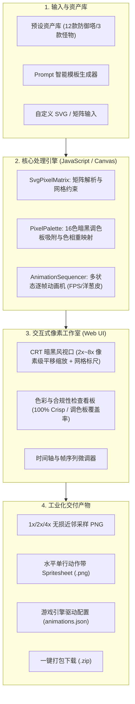

# 《PixelForge AI 像素工坊》产品设计与规格说明书 (SPEC)

> **定位**：面向 2D 独立游戏开发者的 AI 矢量像素美术与逐帧动画生产工作台  
> **目标赛事**：字节跳动 TRAE 好应用大赏赛【内容创作赛道】（主冲“灵感成真奖”，备选“效率革新奖”）  
> **形态**：纯前端轻量化 Web 应用（无需配置后端，可直接托管至 GitHub Pages / Vercel）

---

## 一、 产品愿景与行业痛点

### 1. 行业核心痛点
当前主流图像生成 AI（如 Midjourney、DALL-E、Stable Diffusion）在 2D 像素风独立游戏开发中存在四大致命缺陷：
1. **边缘发虚与半透明杂色**：生成的是栅格抗锯齿图像，放大后像素边缘模糊，无法呈现硬边像素感。
2. **调色板失控**：每次生成颜色随机分散，无法统一到统一的暗黑/复古游戏调色板中。
3. **无法做逐帧动画**：单图生成容易，但连续动作（走、攻、受击、死亡）的帧间一致性极差。
4. **难以对接游戏引擎**：输出单图无法直接作为 Spritesheet 导入 Phaser、Godot、Unity 或自研 Canvas 引擎。

### 2. PixelForge AI 的解决方案
PixelForge AI 提出一套完整的**“规范约束 + 矢量矩阵 + 调色板映射 + 动效管线”**闭环：
- **纯量化 `<rect>` 像素矩阵**：使用 SVG 矢量技术构建严格对齐 $32\times32 / 48\times48$ 整数网格的像素块，声明 `shape-rendering="crispEdges"`，放大 100 倍依然是完美的硬边缘。
- **暗黑 16 色调色板强约束**：内置 Embers 16 色暗黑哥特调色板，提供实时色距（CIEDE/RGB）量化吸附算法。
- **动效状态机与洋葱皮预览**：支持 Walk、Attack、Death 等多动作状态机，支持 1~24 FPS 实时调速、逐帧步进与洋葱皮（Onion Skinning）对比。
- **工业化一键打包交付**：网页端直接通过 Canvas 最近邻采样导出 1x / 2x / 4x 高清 PNG、水平单行动作带 Spritesheet 及标准的 `animations.json` 游戏引擎配置文件。

---

## 二、 架构设计与模块划分



---

## 三、 核心模块详细规格

### 1. 调色板模块 (`PixelPalette`)
- **标准色盘**：Embers Dark Fantasy 16 色标准：
  - **暗部**：`#121016` (极夜黑), `#1E1B24` (冷炭黑), `#2C2636` (暗石灰), `#41394D` (铁影)
  - **铁与石**：`#5C5266` (冷铁), `#7C728A` (铸铁灰), `#A69CB3` (冷银)
  - **火光**：`#5E1B1B` (凝固血褐), `#A12B2B` (暗红), `#D64E2A` (熔岩红), `#F28929` (余烬橙), `#FAD65A` (炽火金)
  - **奥术**：`#1D3B5C` (渊蓝), `#2B6BA6` (雷蓝), `#55A4DB` (冰霜蓝), `#BEE5FA` (辉光亮蓝)
- **方法接口**：
  - `snapColor(hex: string): string`：计算欧几里得距离，将任意十六进制色值吸附到最接近的 16 色之一。
  - `replaceColor(svgText: string, oldHex: string, newHex: string): string`：调色板实时热替换。
  - `getPaletteStats(svgText: string): Map<string, number>`：统计各颜色像素占比。

### 2. SVG 像素矩阵解析器 (`SvgPixelMatrix`)
- **输入**：符合像素风规范的 SVG 文本。
- **校验规则**：
  1. 根节点必须具备 `shape-rendering="crispEdges"`。
  2. `viewBox` 宽高必须为 $32, 48, 64$ 等整数倍网格。
  3. 图元必须严格由 `<rect>` 组成，其 `x, y, width, height` 必须为整数。
- **方法接口**：
  - `validate(svgText: string): { valid: boolean, errors: string[] }`
  - `toPixelGrid(svgText: string): PixelGrid`
  - `rasterize(svgText: string, scale: number): Promise<HTMLCanvasElement>`（采用 `imageSmoothingEnabled = false` 的 Canvas 进行最近邻采样）

### 3. 动画序列状态机 (`AnimationSequencer`)
- **状态支持**：`idle`, `walk`, `attack`, `death`
- **播放控制**：
  - `fps`: 1~24 帧自由调节（默认 6 FPS）
  - `isPlaying`: 播放/暂停
  - `currentFrame`: 选中特定帧进行检查
  - `onionSkin`: 前后帧半透明叠放显示（洋葱皮透光对比）
- **渲染器**：双缓冲 Canvas，渲染当前动作当前帧，支持 2x/4x/6x/8x 放大显示，并可切换像素网格叠加（Pixel Grid Overlay）。

### 4. 工业化导出流水线 (`AssetExporter`)
- **导出规格**：
  - 单帧无损 PNG（1x、2x 导出）
  - 水平排列的 Spritesheet 整合图（例如 4 帧 $32\times32$ 导出为 $128\times32$ 的 1x 图及 $256\times64$ 的 2x 图）
  - JSON 动画元数据文件：
    ```json
    {
      "texture": "ashen_wolf_walk_1x.png",
      "frameWidth": 32,
      "frameHeight": 32,
      "frameCount": 4,
      "frameRate": 6,
      "animations": {
        "walk": { "frames": [0, 1, 2, 3], "loop": true },
        "attack": { "frames": [4, 5, 6], "loop": false },
        "death": { "frames": [7, 8, 9], "loop": false }
      }
    }
    ```
  - 使用纯前端打包库（内置迷你 Zip 生成逻辑或 JSZip CDN）一键下载 `.zip` 压缩包。

---

## 四、 页面交互与评委 2 分钟体验流

评委访问线上部署页面后，无需配置任何环境，走通核心业务流程：
1. **浏览预设与即时审查（30秒）**：
   - 评委在左侧卡牌库中点击任意防御塔（如“雷暴弩炮”或“极地冰霜之塔”），中心主视口瞬间以 $6\times$ 放大展示无模糊边缘的像素图，右侧即时弹出 16 色调色板统计及质量合规性得分（100% CrispEdges、100% Grid-Aligned）。
2. **体验动效审查与洋葱皮（45秒）**：
   - 切换到怪物标签页（如“灰烬恶狼”），点击 `Walk` / `Attack` / `Death`。
   - 拖动 FPS 滑块从 2 调到 12，感受帧率与步进。
   - 开启“洋葱皮（Onion Skin）”复选框，直观查看前后动作帧的形变对齐。
3. **调色板换肤实验（25秒）**：
   - 在右侧调色板选择“火光系”一键将原本是暗紫色的冰霜塔替换为余烬熔岩红，中心画布实时无损更新。
4. **一键工程导出（20秒）**：
   - 点击顶部右上角【一键导出游戏资产包 (ZIP)】，浏览器立即自动下载包含 1x/2x PNG、Spritesheet、SVG 源文件与 JSON 配置的完整标准游戏资产包。
