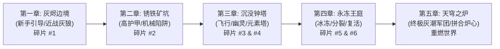
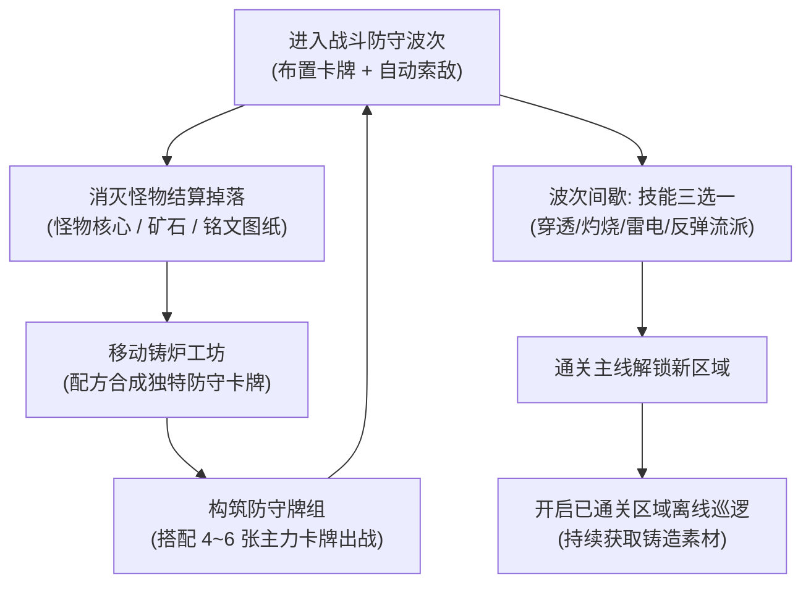

# 《余烬守夜》（EmbersKeep）游戏开发全案与实施规划 (Plan)

> **基于 ChatGPT 核心方案归纳**（源链接：https://chatgpt.com/share/6af739d5-f5c0-83ec-bc65-98d5f2d1b1cb）  
> **项目代号**：EmbersKeep（余烬守夜）  
> **目标发布平台**：TapTap 单机 / 移动端（Android / iOS）  
> **规划版本**：v1.0.0-MVP Release Plan

---

## 一、游戏总体概述 (Game Overview)

### 1. 核心定位与特色卖点
- **游戏类型**：单机放置塔防 + 怪物素材卡牌锻造 + 局内 Roguelike 技能构筑。
- **一句话介绍**：在太阳熄灭的极夜废土中，驾驶移动铸炉收集变异怪物的核心素材，亲手锻造特性迥异的防守卡牌，通过局内技能三选一组合多元流派，找齐七枚炉心碎片，重新点燃天穹之炉。
- **核心差异化体验**：
  1. **告别传统无脑数值开箱**：防御卡牌不靠纯抽卡，而由玩家在战斗中猎杀特定怪物收获核心，通过固定配方在铸炉中亲手锻造（$\text{卡牌} = \text{图纸} + \text{怪物核心} + \text{铭文}$）。
  2. **双层构筑乐趣**：外围永久“卡牌锻造与阵容搭配” + 局内即时“每 2 波 Roguelike 技能三选一与流派联动”。
  3. **放置与策略平衡**：轻度放置护肝，离线巡逻提供基础资源，主线推进注重防线布置与战术抉择。

---

## 二、世界观设定与主线章节规划

### 1. 世界观架构
- **余烬时代**：世界核心的恒星“天穹之炉”熄灭，极寒与黑夜吞没大陆，名为“灰潮”（Ash Tide）的异化巨兽席卷废土。
- **原初铸炉师**：玩家扮演幸存的铸炉师，驾驶着具备防守工事的移动基地——“余烬战车/移动铸炉”。
- **终极主线目标**：跨越五个灾变区域，击败各区域霸主，收集齐**七枚天穹炉心碎片**，重燃世界的火种。

### 2. 主线区域与关卡推进表



| 章节 | 区域名称 | 主题风貌 | 敌方核心特性 | 核心解锁要素 | 关卡规模 |
| :--- | :--- | :--- | :--- | :--- | :--- |
| **Ch.1** | **灰烬边境** | 枯木废墟、灰烬废土 | 低甲灰狼、速度型扑击怪 | 解锁基础木石弩塔、灰狼核心（攻速连射）、锻造工房 | 8 普通 + 1 精英 + 1 Boss + 1 剧情 |
| **Ch.2** | **锈铁矿坑** | 机械废弃矿脉、地底熔岩 | 重装机械傀儡、高甲穿山虫 | 解锁破甲重弩、防守石墙、地雷陷阱、岩甲反伤核心 | 8 普通 + 1 精英 + 1 Boss + 1 剧情 |
| **Ch.3** | **沉没钟塔** | 哥特雾都、残破水钟楼 | 高速蝙蝠飞行怪、幽灵（物免） | 解锁对空高射炮塔、奥术祭坛、雷电范围塔、雷兽核心 | 8 普通 + 1 精英 + 1 Boss + 1 剧情 |
| **Ch.4** | **永冻王庭** | 极夜冰川、冰封要塞 | 减速抗性、亡语分裂虫、冰霜巫妖 | 解锁范围火焰喷射塔、持续灼烧祭坛、多重连携反应 | 8 普通 + 1 精英 + 1 Boss + 1 剧情 |
| **Ch.5** | **天穹之炉** | 浮空星穹锻台、永夜风暴 | 全屏灰潮腐蚀、多重抗性混合大军 | 最终战阵型调配，拼合七枚炉心碎片触发终极防御神技 | 10 史诗决战关卡 |

---

## 三、核心玩法系统架构设计

### 1. 核心闭环生态图


### 2. 卡牌锻造系统 (Card Forging System)
- **卡牌实体公式**：
  $$\text{防守卡牌 (Defense Card)} = \text{基础图纸 (Base Blueprint)} \oplus \text{怪物核心 (Monster Core)} \oplus \text{铭文印记 (Rune Inscription)}$$
- **配方设计准则**：
  - **确定性收益**：特定怪物对应特定核心，核心与图纸合成有明确图鉴指南，拒绝随机开盲盒带来的挫败感。
  - **核心组合示例**：
    - `基础弩箭塔` + `风狼核心` + `轻质弩弦铭文` $\rightarrow$ **疾风双联弩**（超高攻速、击退单体）
    - `基础弩箭塔` + `雷兽核心` + `充能线圈铭文` $\rightarrow$ **雷暴脉冲弩**（攻击附带 4 次连锁闪电）
    - `防御石墙` + `岩甲巨兽核心` + `荆棘钢刺铭文` $\rightarrow$ **荆棘岩壁**（受击反弹 35% 伤害并提供小队护盾）
    - `火焰祭坛` + `火龙幼崽核心` + `余烬扩散铭文` $\rightarrow$ **焚天法阵**（全场地表持续灼烧流）
    - `捕兽夹陷阱` + `毒蝎核心` + `腐蚀毒液铭文` $\rightarrow$ **蚀骨毒沼**（范围减速 50% 并附加最大生命百分比毒伤）

### 3. 局内 Roguelike 技能三选一与四大流派联动
- **触发时机**：关卡每防守过 2 波敌人，界面暂停并弹出 3 个随机战术词条。
- **四大典型战术流派**：
  1. **穿透弹幕流**：`穿云之箭`（投射物穿透+1） + `多重分裂` + `弱点标记`（暴击率提升） $\Rightarrow$ 极速割草低甲群怪。
  2. **全屏灼烧流**：`熔岩之心`（火焰伤害+40%） + `余烬回响`（击杀敌人发生范围爆炸） + `烈焰风暴` $\Rightarrow$ 连锁清场。
  3. **连锁闪电流**：`雷霆共鸣`（连锁伤害不递减） + `感电过载`（受击附加易伤） + `静电场` $\Rightarrow$ 针对群体精英与破盾。
  4. **防守反击流**：`钢铁意志`（基地受击恢复生命） + `绝境充能`（血量越低防御塔攻速越高） + `震荡反冲` $\Rightarrow$ 高压 Boss 战翻盘。

### 4. 放置与离线巡逻收益机制
- **战斗中自动化**：战前布防完成后，战斗过程全自动寻敌与技能释放，仅需在波次间隔做出技能选择。
- **离线巡逻收益**：
  - 玩家可在已通关的章节地图中派遣“侦察小队”进行离线巡逻。
  - 产出内容：基础铁矿、煤炭、低阶怪物残片、铸造金币。
  - **规则限制**：离线巡逻收益上限封顶为 12 小时；**离线不可自动通关未解锁的新关卡**，保证核心挑战乐趣。

---

## 四、视觉基准与 AI 美术资产管线 (Art & Visual Target)

### 1. 12 张核心概念情绪板 (Visual Target & Moodboard)
会话一开篇呈现的 12 张视觉概念图（已完整抓取归档至 [assets/references/concept_art_12/](file:///Volumes/extpan/souceCode/EmbersKeep/assets/references/concept_art_12/)，详见 [visual_target_moodboard.md](file:///Volumes/extpan/souceCode/EmbersKeep/docs/visual_target_moodboard.md)）为整个项目提供了关键的系统设计蓝本：
1. **战斗视角与战场构图 (`concept_01.jpg`)**：确立了 $45^\circ$ 等轴俯视视角（Isometric View）。中心为必须誓死保卫的“移动铸炉/炉火结界”，外围环绕防御塔卡牌插拔槽，敌方暗紫灰狼群从黑夜迷雾中多向围攻。
2. **铸炉工坊 UI 场景 (`concept_02.webp`)**：矮人铸炉师在烈火熔炉前挥锤，身旁堆满发光原石与怪物核心。该图直接作为“卡牌锻造工坊”界面的场景原型（左侧图纸、中间铁砧合成、右侧核心背包）。
3. **世界观与废土氛围 (`concept_03.jpg`, `concept_04.jpg`)**：永夜中被灰潮烈火吞噬的要塞残骸与悬浮余烬粒子，奠定暗黑奇幻基调。
4. **迷雾与光照范围机制 (`concept_05.jpg`)**：参考迷雾光照机制，确立“余烬光照即有效索敌射程”规则。
5. **尸潮压迫感与 Boss 弱点 (`concept_09.jpg`, `concept_11.jpg`)**：确立后期同屏怪群密度标准，以及 Boss 身体带有发光弱点与核心掉落特征。
6. **终局决战场景 (`concept_12.jpg`)**：第五章“天穹之炉”宏大遗迹构图。

### 2. 16-bit 暗黑奇幻像素规范
- **像素基准网格**：
  - 图标、掉落物、核心：$32 \times 32\text{ px}$
  - 普通敌人（灰狼、爬行者）：$32 \times 32\text{ px}$ / $48 \times 48\text{ px}$
  - 防御建筑设施（弩塔、墙、祭坛）：$48 \times 48\text{ px}$ / $64 \times 64\text{ px}$
  - 精英怪与 Boss：$96 \times 96\text{ px}$ 或更大
- **色彩规范**：采用暗黑奇幻 16 色调色板（炭灰暗部、铁锈红、余烬金橙、奥术雷蓝），保证所有素材视觉统一。

### 3. 格式分工与 AI 生成管线
- **静态资产使用 SVG 源码**：
  - 适用对象：防御塔卡牌图面、技能图标、怪物核心与材料图鉴。
  - 规范要求：AI 生成 SVG 必须采用 `<rect>` 像素块矩阵，配置 `shape-rendering="crispEdges"`，透明背景。
- **动态资产使用 PNG 精灵图**：
  - 适用对象：怪物行走/攻击逐帧动作、防御塔射击回弹、爆炸与魔法特效。
- **引擎内渲染规则**：游戏引擎纹理过滤必须配置为**最近邻（Nearest Neighbor）**模式，防止放大时模糊。

### 4. Pilot Triad（验证三件套）
作为美术风格和工程管线的基准验收样本：
1. **基础弩塔 (Crossbow Turret)**：$48 \times 48\text{ px}$，防御建筑代表。
2. **灰烬狼 (Ashen Wolf)**：$32 \times 32\text{ px}$，敌方怪物精灵代表。
3. **雷兽核心 (Thunder Core)**：$32 \times 32\text{ px}$，掉落物材料代表。

---

## 五、技术选型与工程架构设计

### 1. 引擎与技术栈推荐
- **推荐引擎**：**Godot Engine 4.x (2D)** 或 **Web/Pixi.js 原型**（本项目首选跨平台轻量方案）：
  - 极小包体（< 30MB），对 2D 像素与 `TEXTURE_FILTER_NEAREST` 具备开箱即用的原生支持。
  - 纯数据驱动架构（`Resource` 对应卡牌/怪物/技能配置），易于维护 100+ 卡牌与掉落表。
  - 一键导出 TapTap Android APK 与 iOS 安装包。
- **数据存储**：纯本地 JSON / SQLite 加密存档，离线单机即玩，支持本地防作弊校验。

### 2. 项目目录布局规划
```text
EmbersKeep/
├── docs/                               # 策划案、美术规范与设计素材
│   ├── design_materials.md             # 核心玩法与数值设定
│   ├── asset_inventory.md              # 全量64项参考素材纳管台账
│   ├── visual_target_moodboard.md      # 12张核心概念视觉解构与设计指导
│   ├── art_pipeline_spec.md            # 像素美术规范与 AI 提示词
│   └── chat_transcript.md              # ChatGPT 原始构思纪要
├── scripts/                            # 自动化资产管线脚本
│   └── validate_and_rasterize_assets.py# SVG 检查与最近邻位图导出脚本
├── assets/                             # 游戏源资源
│   ├── references/                     # 完整64项参考原画与视觉原型
│   │   ├── concept_art_12/             # 12张世界观与要塞防守核心原画
│   │   ├── pixel_art_12/               # 12张16-bit暗黑奇幻像素标杆（最后咒语等）
│   │   ├── gameplay_td_12/             # 12张放置塔防玩法与UI参考原型
│   │   ├── monster_refs_10/            # 10张异化怪物/巨兽/弱点解剖原画
│   │   ├── chapters_art/               # 5大主线章节环境原画
│   │   ├── systems_ui/                 # 9张卡牌锻造/肉鸽三选一/大地图UI
│   │   └── pixel_pilot_refs/           # 4张像素工程验证素材
│   ├── svg/                            # AI 生成的原始矢量素材
│   │   ├── towers/                     # 防御塔图标
│   │   ├── monsters/                   # 怪物静态展示图
│   │   ├── cores/                      # 怪物核心掉落物
│   │   └── skills/                     # 技能图标
│   ├── textures/                       # 导出后的 32x32/64x64 PNG 精灵图
│   └── audio/                          # 音效与氛围音
├── data/                               # 数据驱动配置表 (JSON / CSV)
│   ├── cards_config.json               # 防守卡牌属性与图纸
│   ├── monsters_config.json            # 怪物数值与掉落概率
│   ├── forge_recipes.json              # 铸造配方表
│   ├── skills_config.json              # Roguelike 技能池
│   └── levels_chapter1.json            # 第一章关卡波次数据
├── src/                                # 游戏业务代码
│   ├── core/                           # 游戏启动、存档管理、事件总线
│   ├── combat/                         # 战斗引擎、索敌、弹道与碰撞
│   ├── cards/                          # 卡牌系统与铸造逻辑
│   ├── progression/                    # 主线关卡、离线挂机结算
│   └── ui/                             # 战斗UI、铸造界面、技能三选一弹窗
└── plan.md                             # 总体开发实施规划（本文件）
```

---

## 六、实施路线图与任务拆解 (Milestones & Tasks)

### 阶段一：资产管线建立与概念原型验证 (已完成 ✅)
- [x] **Task 1.1: 自动化资产处理脚本开发**
  - 编写 `scripts/validate_and_rasterize_assets.py`，实现 SVG `crispEdges` 规范检查与自动转 PNG 功能。
- [x] **Task 1.2: AI 生成 Pilot Triad 基础素材**
  - 生成基础弩塔、灰烬狼、雷兽核心、风狼核心、石墙、火焰祭坛、爬行者、Boss 狼首领等标准 SVG 并导出 1x/2x 像素位图。
- [x] **Task 1.3: 数据驱动基础配置文件搭建**
  - 在 `data/` 下初始化 `cards_config.json`、`monsters_config.json`、`forge_recipes.json`、`skills_config.json`。

### 阶段二：核心战斗引擎与塔防循环 (Web 交互原型已验证 ✅)
- [x] **Task 2.1: 怪物波次生成器与寻路逻辑**
  - 实现基于波次时间轴的怪物孵化（Spawn）、边缘四向包夹、向中心圣炉行进、攻击结界逻辑。
- [x] **Task 2.2: 防御塔索敌与投射物碰撞引擎**
  - 实现最近目标索敌、发射实体弹道、命中伤害结算、连锁闪电传导与余烬爆炸机制。
- [x] **Task 2.3: 战斗暂停与结算状态机**
  - 基地生命值扣减至 0 失败，抵御完全部波次并消灭第 5 波 Boss 判定胜利并产出炉心碎片。
- [x] **Task 2.4: 移动铸炉工坊与战场实时升级/融合系统 (In-Situ Upgrades & Core Mutation)**
  - 实现场外【铸炉工坊】：消耗核心与矿石锻造全新防御建筑卡牌加入卡组。
  - 实现战场【即时升阶强化与核心变异】：点击在场防御设施即弹出强化升级面板（Lv.1~Lv.3 提升伤害、攻速与射程），并可融合【风狼核心】（变异疾风双联弩/疾风荆棘壁）或【雷兽核心】（变异雷霆脉冲弩，四重闪电链），支持一键拆解回收。
  - 实现【坚实城墙防御机制】：具备 58px 范围阻挡拦截、50%~80% 荆棘反伤、每受击3次触发【岩刺爆震】AOE 冲击波与击退、以及提供中央圣火结界 +15% 护体减伤。
- [x] **Task 2.5: 波次间隔 Roguelike 技能三选一联动**
  - 波次 2/4 暂停弹出三选一卡牌，动态应用穿透、余烬回响、熔岩之心、钢铁意志等流派词条。
- [x] **Task 2.6: 暗黑奇幻 UI 视效与战场沉浸感全面重构 (Dark Fantasy Visual Overhaul)**
  - **外框与字体**：引入哥特式四角金属铆钉包角（Corner Ornaments）与 `Cinzel` / `JetBrains Mono` 游戏字体。
  - **状态栏 HUD**：重构为游戏级状态栏，实现圣炉生命核心能量条、波次推进轨迹轨（Wave Rail 带 Boss 标记）、无折行核心储备栏与铸铁按钮。
  - **实体手牌战壕 (Tactile Deck)**：将底部按钮升级为具备金框、插画、战术属性条与 `[1~4]` 快捷键的实体卡牌，支持键盘秒切。
  - **要塞战场地貌与去 CAD 线框感**：45° 等轴古石地砖地表、边缘暗夜迷雾动态光照辐射、跳动的多层像素熔火核心、隐去平时生硬 CAD 黄圈（仅悬浮淡显符文法阵）、城墙幽蓝能量流动光丝。

### 阶段三：AI 像素美术与逐帧动画资产全量管线 (已完成 ✅)
- [x] **Task 3.1: 12 张核心防御卡牌矢量资产全量构建**
  - 严格采用 AI SVG crispEdges `<rect>` 像素块矩阵，完整生成：连弩塔、火焰坛、石墙、捕兽陷阱、疾风连射弩、雷霆脉冲弩、荆棘岩壁、焚天余烬坛、寒霜凝结塔、重型臼炮、毒液投石机、虚空引力信标。
  - 自动近邻采样编译为 1x ($32\times32$) 和 2x ($64\times64$) 像素位图并挂载至配置表。
- [x] **Task 3.2: 第一章 3 大怪物全套动作逐帧序列生成（共29帧）**
  - **灰烬狼 (32x32)**：Walk (4帧迈步循环)、Attack (3帧飞扑撕咬)、Death (3帧受创消融)。
  - **灰潮爬行者 (32x32)**：Walk (4帧节肢爬行)、Attack (3帧巨螯酸液喷溅)、Death (3帧甲壳碎裂)。
  - **灰狼首领·残烬之影 (48x48)**：Walk (4帧王者阔步)、Attack (4帧撼地狂暴爪痕裂痕)、Death (4帧天穹碎片升腾决战动画)。
  - 自动编译为水平透明 Spritesheet 并沉淀 `data/animations_config.json` 动效切片元数据。
- [x] **Task 3.3: 交互式美术与逐帧动画演播厅 (Gallery Studio)**
  - 交付 [gallery.html](file:///Volumes/extpan/souceCode/EmbersKeep/gallery.html)，支持怪物/动作切换、播放暂停、FPS滑块调节、逐帧点选、2x~6x 像素放大，以及 12 张卡牌属性全景图鉴。

### 阶段五：第一章主线关卡与 Boss 战 (Week 6)
- [ ] **Task 5.1: 第一章（灰烬边境）8 个关卡配置**
  - 编排循序渐进的怪物波次与难度曲线。
- [ ] **Task 5.2: 区域 Boss“灰狼首领”机制实现**
  - 实现双阶段战斗：狂暴冲锋、召唤灰狼爪牙、高额破壁打击。
- [ ] **Task 5.3: 第 1 枚炉心碎片剧情演出与奖励结算**
  - 通关 Boss 触发碎片拼接剧情动画，解锁移动铸炉第二阶。

### 阶段六：放置挂机巡逻、存档与 TapTap 上架准备 (Week 7)
- [ ] **Task 6.1: 离线巡逻收益算法**
  - 依据已通关关卡与离线时间差计算资源，封顶 12 小时。
- [ ] **Task 6.2: 本地安全存档与容错恢复**
  - 存档版本迁移、校验和防篡改。
- [ ] **Task 6.3: 移动端适配与 TapTap 规范接入**
  - 触控操作优化、横竖屏自适应、帧率优化与打包测试。

---

## 七、关键风险与应对策略 (Risks & Mitigations)

1. **风险：AI 生成的像素素材风格杂乱不统一**
   - **应对策略**：统一引用 `docs/art_pipeline_spec.md` 中的 16 色标准调色板；通过脚本严格限制使用 `<rect>` 矩阵生成 SVG，并在后期处理中统一色彩聚类。
2. **风险：卡牌锻造种类过多导致数值失衡**
   - **应对策略**：MVP 首版严格控制在 12 张核心卡牌与 30 种技能内；采用模块化公式计算 DPS 与生命周期价值（EHP），先做流派克制，后调数值倍率。
3. **风险：放置塔防缺乏持续在线操作感**
   - **应对策略**：每 2 波一次的 Roguelike 技能三选一极大提升单局策略密度；加上特定怪物的“核心掉落期待感”，保持玩家的主动探索驱动力。
